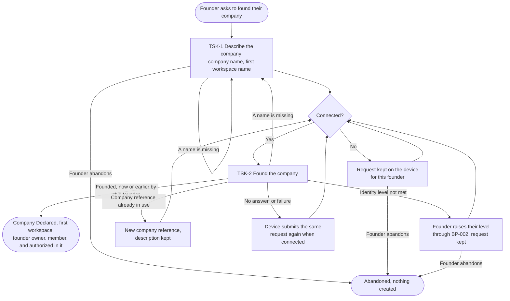
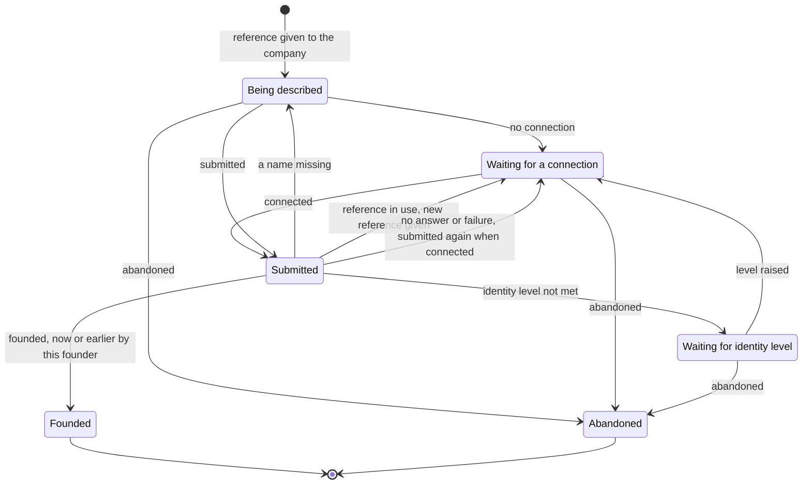

# BP-001 — Found a company

## Intent

A construction company director wants to start running their company's operations on the
platform. Founding gives them, at once, a company on the platform, its first workspace, and the
right to act in it, so that they can create sites and invite their team next.

## Actor and trigger

- **Actor**: the founder, a person signed in to the platform. Self-service: nobody on the platform
  side takes part.
- **Trigger**: the founder asks to found their company.

## Boundary

- **Starts** when a signed-in person asks to found a company.
- **Ends** when the company exists, Declared, with its first workspace, the founder is its owner
  and its first member, and the founder may act in that workspace; or when the founder abandons
  the request.

Out of this process:

| Out | Owner |
|---|---|
| Creating an account, signing in, the identity levels a process can require | BP-002 |
| Inviting someone, joining an organization, ending a membership or an access | BP-003, BP-004, BP-005 |
| Creating a site | BP-006 |
| Adding a workspace, transferring ownership, verifying the company | BP-007, BP-008, BP-009 |
| Roles, permissions, delegation, or any right at the scope of the whole organization | No process produces them yet |
| Subscription and billing | Not yet a process |

Founder access is the right to take part in the first workspace, not a set of rights: it is never
read as "may do everything".

## Precondition

The founder is signed in. The identity level founding requires (decision BP001-D1) is checked when
the company is founded (TSK-2), not before the founder describes it, so that a description is never
lost to a missing level.

## Flow

## Tasks

### TSK-1 — Describe the company

| | |
|---|---|
| Trigger | The founder asks to found their company. |
| Performed by | The founder. |
| Preconditions | The founder is signed in. |
| Inputs | The company name; the name of its first workspace. |
| Rules | Both names are required; a name that is empty or made only of spaces counts as missing. The company name is offered as the default first workspace name. Names are taken as declared (INV-ACCESS-08). When the description starts, the company to found receives its **reference**, which stays the same for every submission of this request (rule BP001-R3). From its first submission until the company is founded, the description cannot be changed, except when the answer is that a name is missing; to found with other names, the founder abandons the request and starts a new one. The description survives the founder leaving the screen, closing the application, or losing the connection, until the company is founded or the founder abandons it. It belongs to the founder who started it (rule BP001-R6). |
| Outputs | A founding request: the two names and the company's reference. |
| Errors | A name is missing: the founder is told which, nothing is created, the description is kept. |
| Event | Founding requested. |

### TSK-2 — Found the company

| | |
|---|---|
| Trigger | A founding request is submitted while connected. |
| Performed by | The platform. |
| Preconditions | The founder meets the identity level when the request is processed (BP001-D1). |
| Inputs | The founding request; the signed-in founder, never a person named in the request (rule BP001-R2). |
| Rules | In one indivisible step, the platform creates: the founder's profile if they have none (INV-ACCESS-01); the organization, Declared (INV-ACCESS-08), under the request's reference; its first workspace (INV-ACCESS-03, INV-ACCESS-04); the founder's ownership (INV-ACCESS-02); the founder's membership (INV-ACCESS-06); the founder's access to that workspace and to no other (INV-ACCESS-07, rule BP001-R4). Either all of it, profile included, exists afterwards, or none of it does. The three relations are created together but none is derived from another (INV-ACCESS-05). |
| Outputs | The founded company and its first workspace, which the founder can enter. |
| Errors | A name is missing: back to TSK-1, nothing created. The identity level is not met: refused, nothing created, the request is kept while the founder raises their level through BP-002. The reference already identifies a company this founder owns: that company is returned and nothing new is created (rule BP001-R3). The reference already identifies any other company, including one the founder belongs to without owning it: refused, the founder learns only that the reference is in use (INV-ACCESS-09); the request receives a new reference and may be submitted again. No answer, or any other failure: nothing created by this submission; the device submits the same request again when connected, and after repeated failures the founder is told and may abandon. |
| Event | Company founded. |

## States of a founding request

A request can end Founded only once, however many times it is submitted.

## Rules of this process

- **BP001-R1** — Any signed-in person who meets the identity level may found a company, including a
  person who already owns or belongs to another one. Founding a second company is the same process.
- **BP001-R2** — The founder is always the signed-in person who submits the request.
- **BP001-R3** — One founding request produces at most one company, however many times it is
  submitted, including at the same time. The request is recognized by its company's reference.
  For this process, a repeated request is one whose reference identifies a company owned by the
  submitting person; any other use of the reference is refused. This applies the shared convention
  of `naming.md`, section "Aggregate identifiers".
- **BP001-R4** — The founder's access covers the first workspace only. Access to later workspaces is
  attributed by the processes that create them.
- **BP001-R5** — Two founders may declare the same company name. Each gets their own organization,
  and neither learns of the other (INV-ACCESS-09).
- **BP001-R6** — A kept request belongs to the person who described it. It is submitted only while
  that person is signed in on the device. If someone else signs in, it is neither submitted nor
  shown to them.

## Decisions of this process

- **BP001-D1 — Identity level for founding.** Founding requires the lowest identity level that BP-002
  defines: a confirmed contact. The levels themselves are defined by BP-002.
- **BP001-D2 — Founding requires a connection.** Nothing about a company can be used before it is
  founded, so founding is not done offline. The request is kept on the device and submitted once
  connected (TSK-1, TSK-2, BP001-R6).

## Reading ADR-PROD-002

ADR-PROD-002 cites "task TSK-2 and rule RULE-3" of the July version of this process. They
correspond here to TSK-1 (describing the company) and to INV-ACCESS-08 (the organization is taken
as declared). Its decision is unchanged.

## Open questions

- What, beyond the two names, the company must declare before its first site (trade, country,
  registration number). Nothing else is required for founding today.
- Whether the number of companies one person may found is ever limited for product reasons, as
  opposed to abuse protection.
- Whether to warn a founder who submits a second request with the same company name from another
  device, which on a poor connection may found two companies they both own.
- Whether, and where, a founder is offered to join an existing company with a similar name. It
  would reveal that company to a non-member, which INV-ACCESS-09 forbids outside an invitation.
