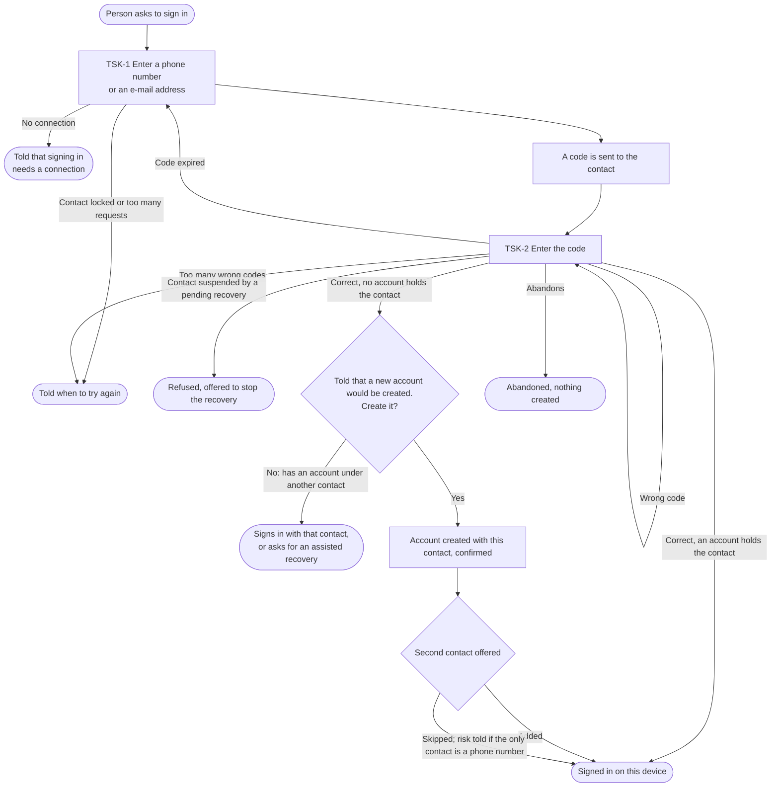
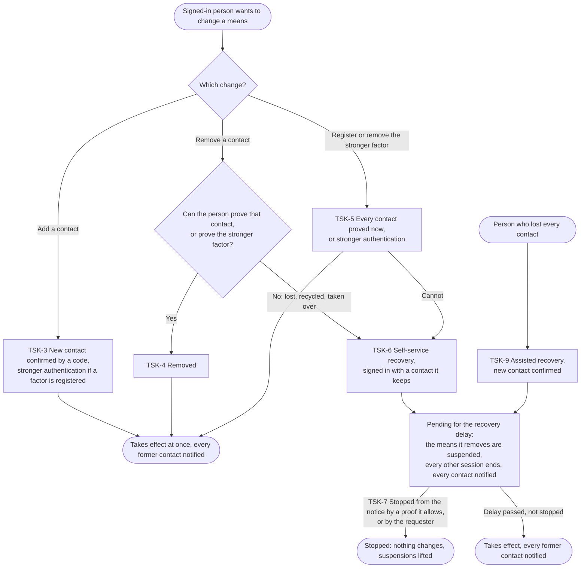
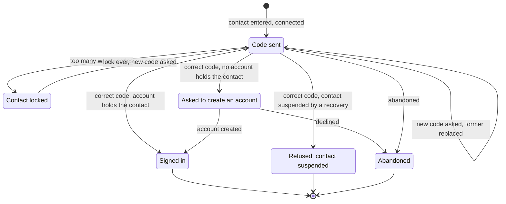
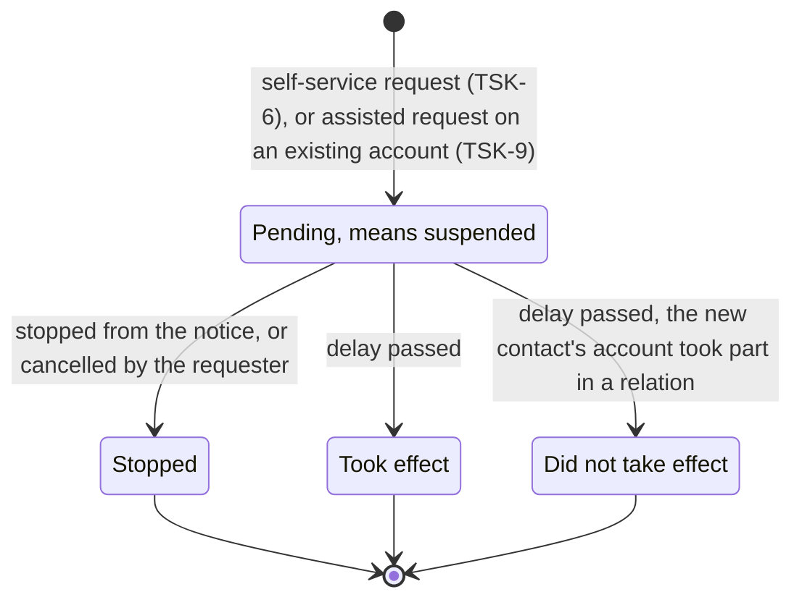
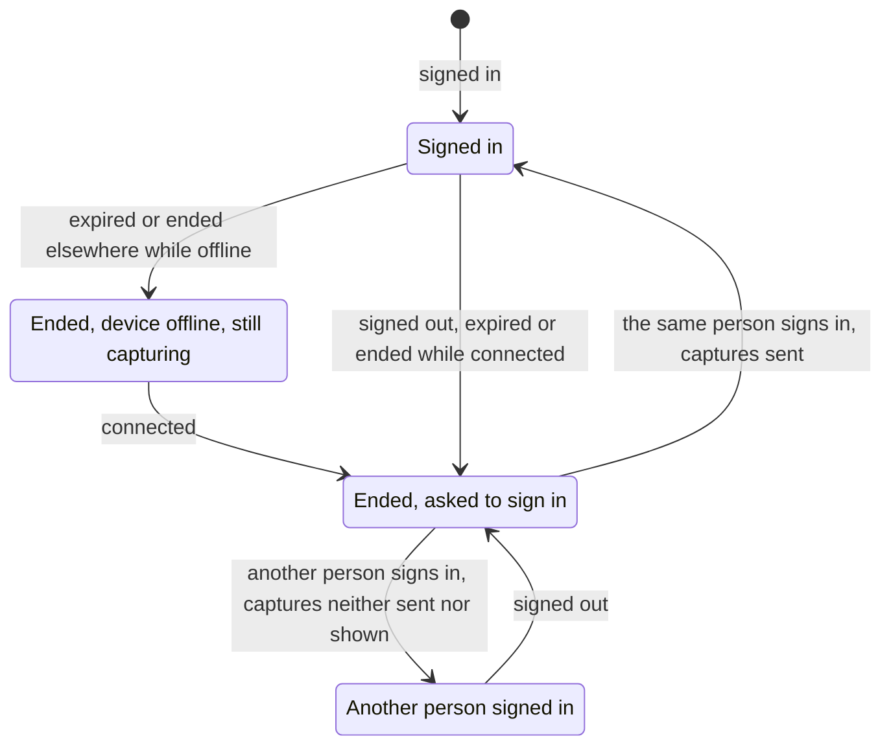

# BP-002 — Access the platform

## Intent

A person who works for a construction company, a director, a site manager or a worker, wants to
use the platform from their phone: to be recognized, to come back to it, and not to lose their
account when they lose a phone or a phone number. Accessing the platform gives them an account
that only whoever controls its contacts can sign in to (rule BP002-R6), and a way back to it
when a means of signing in is lost.

Field reality shapes every rule below: the phone is used outdoors, with gloves, on a poor or
absent network; not everyone has an e-mail address; phone numbers get lost, change hands and get
recycled.

## Actor and trigger

- **Actor**: the person, who has an account or is about to create one.
- **Triggers**:
  - a person who is not signed in asks to sign in, whether or not they have an account;
  - a signed-in person asks to change how they sign in: a contact or their stronger factor;
  - a person asks to recover their account, through another contact or with the operator's help;
  - a person acts on a notice they received: to stop a recovery, or to dispute an event.

## Boundary

- **Starts** when one of the triggers above occurs.
- **Ends** when the person is signed in on the device (their account created the first time);
  when a change of their means of signing in has taken effect or been refused; when a recovery
  has taken effect or been stopped; when a session has ended; or when the person abandons.

Nothing on the platform is used without being signed in to an account: there is no anonymous
use.

Out of this process:

| Out | Owner |
|---|---|
| Founding a company | BP-001 |
| Inviting someone, joining an organization, ending a membership or an access | BP-003, BP-004, BP-005 |
| Transferring ownership, verifying a company | BP-008, BP-009 |
| Creating a profile: signing in creates an account, never a profile (INV-ACCESS-01) | BP-001, BP-004 |
| Closing an account at the person's request | No process yet |
| Verifying a civil identity | No process requires one |
| Synchronizing what was captured, once it may be sent | The process that captures it |

The person is external to the product (ADR-ARCH-031 §2); their account, its contacts and its
stronger factor sit with them, outside Access (`docs/domain/access.md`, section Identity).

## Precondition

None for the process as a whole: anyone may ask to sign in, and a person who cannot sign in may
still stop a recovery from a notice or ask for an assisted recovery. Each task states its own
preconditions; every task that reaches the platform requires a connection (rule BP002-R16).

## Actors

| Actor | Kind | Part |
|---|---|---|
| The person | Human | Signs in, changes their means of signing in, recovers, stops a recovery, disputes. |
| The platform | System | Sends codes, signs people in, applies every rule below, sends the notices. |
| The platform operator | Human, platform side | Takes an assisted recovery and records disputes. Changes no account on their own judgement. |
| Another person on the same device | Human | Signs in on a phone someone else used before them. |
| Whoever else controls a contact of the account | Human | A thief holding a lost phone, the new holder of a recycled number, someone who took over a phone number. They receive the codes sent to that contact. |
| The delivery of a code to a contact | External | Carries a code to a phone number or an e-mail address. How is not decided here. |

## Means of signing in

An account's **means** are its contacts and, if the person registered one, its stronger factor
(`docs/domain/access.md`, section Identity). A contact belongs to at most one account
(INV-ACCESS-10). A **code** is a one-time code that the platform sends to one contact; entering
it proves control of that contact.

## Flow

### Signing in, and creating an account

### Changing the means, and recovering

## Tasks

### TSK-1 — Ask for a code

| | |
|---|---|
| Trigger | A person who is not signed in, or who must prove a contact for an operation, enters a phone number or an e-mail address. |
| Performed by | The person, then the platform. |
| Preconditions | The device is connected (rule BP002-R16). |
| Inputs | One contact. |
| Rules | The contact is read as rule BP002-R5 states. The platform sends a code to it (rule BP002-R1). Requests for codes to one contact are limited (rule BP002-R3). The answer is the same whether or not an account holds the contact (rule BP002-R2). |
| Outputs | A code sent to the contact. |
| Errors | No connection: told that signing in needs one, nothing sent. Not a phone number nor an e-mail address: told so. The contact is locked, or too many codes were asked for it: told when to try again, nothing sent. |
| Event | Code sent. |

### TSK-2 — Enter the code, and sign in

| | |
|---|---|
| Trigger | The person enters the code they received. |
| Performed by | The person, then the platform. |
| Preconditions | A code was sent to the contact (TSK-1). The device is connected. |
| Inputs | The contact; the code. |
| Rules | The code is accepted only if it is the latest code sent to that contact, has not expired and has not been used (rule BP002-R1). A wrong code counts towards the lock of that contact (rule BP002-R3). With a correct code: if an account holds the contact and the contact is not suspended, the person is signed in on this device; if the contact is suspended by a pending recovery, the sign-in is refused with the offer to stop that recovery (rule BP002-R10, TSK-7). If no account holds the contact, the person is told so, and told that a new account would be created; they are offered, instead, to sign in with another contact if they already have an account, or to ask for an assisted recovery if they lost every contact (TSK-9). Only if they confirm is an account created, holding this contact, confirmed (decision BP002-D1). A second contact is then offered (decision BP002-D2); if the only contact is a phone number, the person is told the risk it carries (decision BP002-D2). Signing in creates no profile (INV-ACCESS-01). |
| Outputs | A session of this person on this device; the first time, a new account. |
| Errors | Wrong code: told so, may enter it again. Code expired or replaced: told so, may ask for a new one (TSK-1). Too many wrong codes: the contact is locked for a time, told when to try again; during the lock even the right code is refused. Contact suspended: refused, offered to stop the recovery. The person declines to create an account: nothing is created. |
| Event | Signed in; on the first sign-in, Account created. |

### TSK-3 — Add a contact

| | |
|---|---|
| Trigger | A signed-in person asks to add a contact, or accepts the second contact offered. |
| Performed by | The person, then the platform. |
| Preconditions | The person is signed in. No recovery of the account is pending (rule BP002-R12). |
| Inputs | The new contact. |
| Rules | The new contact is proved by a code sent to it (TSK-1, TSK-2), and is then confirmed. If the account has a stronger factor, stronger authentication is required too (rule BP002-R7). Until the code is entered, the answers are those of signing in; only after it is the person told that the contact already belongs to another account (rule BP002-R2). The person is told to add only a contact that they alone control (rule BP002-R6). The addition takes effect at once and is notified to every contact the account held before (rule BP002-R15). |
| Outputs | The account holds the new contact, confirmed. |
| Errors | Wrong, expired or locked code: as in TSK-2. The contact already belongs to another account (INV-ACCESS-10): refused, nothing changes, the other account is unchanged. Stronger authentication not given or failed: refused, nothing changes. A recovery is pending: refused, told so. |
| Event | Contact added. |

### TSK-4 — Remove a contact

| | |
|---|---|
| Trigger | A signed-in person asks to remove a contact, or to change one (rule BP002-R7). |
| Performed by | The person, then the platform. |
| Preconditions | The person is signed in. The account holds another confirmed contact, which stays (rule BP002-R4). No recovery is pending. |
| Inputs | The contact to remove. |
| Rules | The person proves now either the contact removed, by a code sent to it, or the stronger factor if the account has one (rule BP002-R7). The removal takes effect at once and is notified to every contact the account held before, the removed one included (rule BP002-R15). A person who cannot give either proof, because the contact is lost, recycled or in other hands, recovers instead (TSK-6). Changing a contact is adding the new one (TSK-3) and removing the former one (this task), done as one operation for the person. |
| Outputs | The account no longer holds the contact. |
| Errors | It is the last contact: refused, the person may change it instead. Proof not given or failed: refused, nothing changes, and the person is told about the self-service recovery. A recovery is pending: refused. |
| Event | Contact removed. |

### TSK-5 — Register, replace or remove the stronger factor

| | |
|---|---|
| Trigger | A signed-in person asks to register a stronger factor, to replace it, or to remove it. |
| Performed by | The person, then the platform. |
| Preconditions | The person is signed in. No recovery is pending. |
| Inputs | The stronger factor to register, or the one to replace or remove. |
| Rules | Registering the first one requires proving now every contact of the account: once registered, it protects changes to all of them. Replacing or removing it requires stronger authentication with it, or proving now every contact of the account (rule BP002-R7). Repeated failed proofs of the stronger factor lock it for a time (rule BP002-R3). Every change is notified to every contact of the account (rule BP002-R15). A person who lost their stronger factor and cannot prove every contact recovers instead (TSK-6). |
| Outputs | The account holds the new stronger factor, or none. |
| Errors | A proof not given or failed: refused, nothing changes. The factor is locked: told when to try again. A recovery is pending: refused. |
| Event | Stronger factor registered; Stronger factor removed. |

### TSK-6 — Recover through another contact

| | |
|---|---|
| Trigger | A signed-in person reports that one or more of their means are lost or are not theirs: a contact, the stronger factor, or both. |
| Performed by | The person, then the platform. |
| Preconditions | The person is signed in with a contact that the recovery keeps. No recovery of the account is pending (rule BP002-R12). |
| Inputs | The means it removes; optionally a new contact. |
| Rules | This is the primary way back to an account, and it is never weaker than signing in (rule BP002-R9). A new contact is proved by a code at once, and is added only when the recovery takes effect; if it already belongs to another account, rule BP002-R14 applies. If the recovery adds a contact while the account keeps a stronger factor, stronger authentication is required (rule BP002-R8). From the request, the means it removes are suspended (rule BP002-R10) and every other session of the account ends. Every contact the account holds, the suspended ones included, is notified at once, with the way to stop the recovery from the notice (rule BP002-R15). The recovery takes effect when the recovery delay (rule BP002-R13) has passed, unless it was stopped (TSK-7). |
| Outputs | A pending recovery; once it takes effect, the means it named removed and the new contact added. |
| Errors | It would leave no contact: refused. A recovery is already pending: refused, the person is told so and how to stop it. The new contact's code is wrong, expired or locked: as in TSK-2. The new contact belongs to an account that has a profile: refused (rule BP002-R14). Stronger authentication required and not given: refused. |
| Event | Recovery requested; Recovery took effect. |

### TSK-7 — Stop a pending recovery

| | |
|---|---|
| Trigger | A person acts on the notice of a pending recovery, or is offered to stop it when a sign-in with a suspended contact is refused; or the requester of a self-service recovery cancels it. |
| Performed by | The person who received the notice, or the requester; then the platform. |
| Preconditions | A recovery of the account is pending. |
| Inputs | A proof that rule BP002-R11 allows for this recovery. |
| Rules | The stop is reachable from the notice without signing in (rule BP002-R11). It is the only way a recovery ends before its delay has passed, apart from its requester cancelling it (rule BP002-R8). A stopped recovery changes nothing: the suspensions are lifted, and nothing it named is removed or added. The stop is notified to every contact of the account (rule BP002-R15). |
| Outputs | The recovery is stopped. |
| Errors | The proof given is not one this recovery allows, or fails: refused, the recovery stays pending. The recovery has already taken effect: told so, and told about the dispute (TSK-8) and, if they hold no contact of the account any more, the assisted recovery (TSK-9). |
| Event | Recovery stopped. |

### TSK-8 — Dispute an event

| | |
|---|---|
| Trigger | A person who received a notice of an event that has taken effect does not recognize it. |
| Performed by | The person, then the platform operator. |
| Preconditions | The person received a notice (rule BP002-R15), which gives the operator's contact information. |
| Inputs | The notice; what the person reports. |
| Rules | The operator records the dispute, and directs the person to the path that reverses the event: removing a contact (TSK-4), the self-service recovery (TSK-6), or, if they hold no contact of the account any more, the assisted recovery (TSK-9). The operator changes no account on a dispute alone. |
| Outputs | A recorded dispute; the person knows the path to take. |
| Errors | None of its own. |
| Event | Event disputed. |

### TSK-9 — Assisted recovery

| | |
|---|---|
| Trigger | A person who can sign in with no contact of their account asks the platform operator to recover it, through the operator's contact information, which is reachable without signing in. |
| Performed by | The person and the platform operator, then the platform. |
| Preconditions | None about the account: the operator does not know yet whether one exists. The device is connected. |
| Inputs | At least one former contact of the account; a new contact. |
| Rules | Decision BP002-D3 governs this task. The new contact is proved by a code; if it already belongs to another account, rule BP002-R14 applies. The operator establishes nothing more. The answer to the request is the same whether or not an account holds the former contact named, and whether or not a recovery is already pending on it; a request on an account where a recovery is pending has no effect (rule BP002-R12). If an account holds the former contact: from the request, every means of that account is suspended (rule BP002-R10), every session of the account ends, and every contact of the account is notified at once, with the way to stop the recovery from the notice (rule BP002-R15). The recovery takes effect when the recovery delay has passed, unless it was stopped (TSK-7). When it takes effect, every former contact and the stronger factor are removed, the new contact is the account's only contact, and every former contact is notified. The account is kept, with its profile and every relation. The operator keeps a record of the request (decision BP002-D3). The requester learns the outcome only when the delay has passed, by signing in with the new contact. |
| Outputs | A pending recovery; once it takes effect, the account reached through the new contact. |
| Errors | The new contact's code is wrong, expired or locked: as in TSK-2. The new contact belongs to an account that has a profile: refused (rule BP002-R14). |
| Event | Assisted recovery requested; Recovery took effect. |

### TSK-10 — End a session

| | |
|---|---|
| Trigger | A signed-in person signs out of this device, or asks to end their sessions on every other device, for example after losing a phone. |
| Performed by | The person, then the platform. |
| Preconditions | The person is signed in. Ending the sessions of other devices requires a connection. |
| Inputs | Which sessions: this one, or every other one. |
| Rules | An ended session can no longer send anything under the person. What the person captured on a device and has not sent stays on that device, for that person only (decision BP002-D4); a person who signs out with unsent captures is told so. |
| Outputs | The sessions ended. |
| Errors | No connection when ending other sessions: told that it needs one, nothing ended. |
| Event | Session ended. |

### TSK-11 — Keep capturing after a session ends offline

| | |
|---|---|
| Trigger | A person's session expires, or is ended elsewhere, while their device has no connection. |
| Performed by | The person, then the device. |
| Preconditions | The person was signed in on the device. |
| Inputs | What the person captures. |
| Rules | Decision BP002-D4 governs this task. The person keeps capturing on the device until the device learns, when connected, that the session has ended; then they are asked to sign in again. What they captured belongs to them on that device. It is sent only once the same person has signed in again on that device. If another person signs in on that device, it is neither sent under them nor shown to them. |
| Outputs | Captures kept on the device for their author, sent once that person has signed in again. |
| Errors | None of its own. Sending what was captured is the capturing process's. |
| Event | Session ended offline; once the person signs in again, Signed in. |

## Rules of this process

- **BP002-R1 — Codes.** A code is sent to one contact, works once, and expires after a limited
  time. Asking for a new code replaces the former one, which no longer works.
- **BP002-R2 — Nothing reveals an account before its contact is proved.** The answers to asking
  for a code, to a wrong code, to an expired code and to a lock are the same whether or not an
  account holds the contact. Only after entering a correct code does the person learn whether an
  account holds it: they have proved that they control it.
- **BP002-R3 — Failed attempts are limited for each means.** Repeated wrong codes for one
  contact, or repeated failed proofs of a stronger factor, lock that means for a time. The other
  means of the account still work. Requests for codes to one contact are limited too. This applies
  NIST SP 800-63B-4 §3.2.2 (failed attempts limited per authenticator). Known exposure, accepted:
  anyone can lock a contact by entering wrong codes for it, so a person whose only contact is a
  phone number can be kept from signing in while the lock lasts. The lock is temporary, and a
  second contact (decision BP002-D2) avoids it. A lock never prevents stopping a recovery (rule
  BP002-R11).
- **BP002-R4 — An account always holds at least one confirmed contact.** The last contact
  cannot be removed, only changed.
- **BP002-R5 — One contact, however written.** Two writings of the same phone number are one
  contact; a phone number is recorded with its country code. An e-mail address is compared
  without regard to letter case.
- **BP002-R6 — A contact is a means of signing in.** Whoever controls a contact can sign in with
  it. The person is told to add only a contact that they alone control, never a relative's or a
  colleague's.
- **BP002-R7 — What each change of the means requires.** Every change requires being signed in,
  takes effect at once, and is notified to every contact the account held before it (rule
  BP002-R15):

  | Change | Requires, in addition |
  |---|---|
  | Add a contact | A code entered for the new contact; stronger authentication if the account has a stronger factor. |
  | Remove a contact | Another confirmed contact staying; a code entered now for the contact removed, or stronger authentication. |
  | Change a contact | Adding the new one and removing the former one, as above, in one operation. |
  | Register the first stronger factor | A code entered now for every contact of the account. |
  | Replace or remove the stronger factor | Stronger authentication with it, or a code entered now for every contact of the account. |

  A change whose proof the person cannot give is made through a recovery (TSK-6). This applies
  NIST SP 800-63B-4 §4.1.2.1 (binding a means requires authentication first, and is notified) and
  §3.1.3.3 (setting or changing a phone number is binding a new authenticator).
- **BP002-R8 — One rule for every recovery.** A recovery never removes a contact whose holder
  proves it during the delay; proving it from the notice is the stop. Only a deliberate stop,
  proved from the notice, ends a recovery before its delay has passed; the requester of a
  self-service recovery may also cancel it. A correct code entered to sign in with a suspended
  contact does not stop the recovery by itself: it leads to the offer to stop it (rule
  BP002-R10), which the holder takes or not.

  An operation requires inside a recovery the proof it requires outside one:
  - **What a recovery adds** requires that proof when the recovery is requested. A recovery that
    adds a contact while the account keeps a stronger factor requires stronger authentication.
  - **What a recovery removes** is removed only if nobody who could give that proof gives it
    during the delay: its holder's proof, given from the notice, is the stop. A recovery that
    removes a contact is stopped by proving that contact. A recovery that removes the stronger
    factor is stopped, from the notice, by proving that factor or any contact the recovery keeps
    (rule BP002-R11).

  (Maintainer's directions, 2026-11-24, on #247.)
- **BP002-R9 — The self-service recovery is never weaker than signing in.** It requires signing
  in with a contact that it keeps, which is the proof signing in requires. It removes nothing
  that its holder proves during the delay (rule BP002-R8), and it adds nothing without the proof
  that adding requires outside a recovery. What it gives beyond signing in is removing a means
  that nobody proves within the delay; that is stated and accepted below (section Residual risks
  of the self-service recovery). It is the primary way back to an account; the second contact of decision BP002-D2 is
  offered so that it is possible. The rule "a recovery is never a weaker path than signing in"
  applies to it; the assisted recovery is the stated exception (decision BP002-D3). (Maintainer's
  direction, 2026-11-24.)
- **BP002-R10 — Suspension during a recovery.** From the request until the recovery takes
  effect or is stopped, the means it removes are suspended: they authorize no change, a sign-in
  attempt with a suspended contact is refused with the offer to stop the recovery, and a code
  sent to a suspended contact serves only to stop it. The notices still go to suspended
  contacts.
- **BP002-R11 — Who can stop a recovery.** During the delay, from the notice and without signing
  in, a recovery is stopped by whoever proves:
  - a contact it suspends;
  - the stronger factor, if it removes it;
  - any contact it keeps, if it removes the stronger factor.

  The requester of a self-service recovery may also cancel it while signed in.

  What proves the stop reaches each contact with its notice. Failed attempts at it are limited
  for that notice alone: a lock of the contact (rule BP002-R3), or wrong attempts made by anyone
  without that notice, never prevent its holder from stopping the recovery.
- **BP002-R12 — One recovery at a time.** At most one recovery is pending on an account. While
  one is pending, no other change of the means is made, except stopping it. A self-service
  request while one is pending is refused, and the person is told how to stop the pending one;
  an assisted request has no effect (TSK-9).
- **BP002-R13 — The recovery delay.** Both recoveries take effect only once the recovery delay
  has passed. The delay is sized for a person who may stay offline for several days on a site, so
  that they receive the notice and can stop a recovery that is not theirs. (Maintainer's
  direction, 2026-11-24.)
- **BP002-R14 — A new contact that already holds an account.** A recovery may take, as its new
  contact, a contact held by an account that has never taken part in a relation, and therefore
  has no profile (INV-ACCESS-01): a person who changed number and signed in with the new number
  may have created one by mistake. When the recovery takes effect, that account ends: its
  contact passes to the recovered account, its other contacts and its stronger factor are
  released, and every contact it held is notified that it ended. A contact held by an account
  that has a profile, because it takes or once took part in a relation, is refused, even if every
  relation it took part in has ended. This rule is applied when the recovery is requested and
  again when it would take effect, whatever the new contact's state at the request: if by then
  the new contact belongs to an account that has a profile, or to an account created during the
  delay that has one, the recovery does not take effect, and the person is told.
- **BP002-R15 — Notices.** Every change of the means, and every recovery when it is requested,
  when it takes effect and when it is stopped, is notified at once to every contact the account
  held before it, the removed, suspended or lost ones included. Each notice says what happened
  and when, gives the platform operator's contact information and how to dispute the event
  (TSK-8), and, for a pending recovery, how to stop it without signing in (TSK-7). This applies
  NIST SP 800-63B-4 §4.2.3 (every recovery notified) and §4.6 (every notification address, with
  instructions and contact information).
- **BP002-R16 — A connection is required.** Signing in, every change of the means, a recovery
  and a stop require a connection. Capturing does not (decision BP002-D4).

## Recovery situations

How each situation is met. "Second contact" means a contact of the account other than the one
lost.

| Situation | With a second contact | With no second contact |
|---|---|---|
| Lost phone, number still the person's | Sign in with the second contact, end the lost phone's sessions (TSK-10). If someone holds the phone with its SIM card, have the carrier block it, then recover the number (TSK-6) or keep it once a new SIM card is issued. | Get a new SIM card with the same number from the carrier and sign in as before; until then, the person cannot sign in. If the number is lost for good: assisted recovery (TSK-9). |
| Recycled number | Sign in with the second contact and recover the number (TSK-6). From the request, its new holder can no longer sign in to the account. They receive the notice, and by proving the number they can stop the recovery and keep signing in (residual risk below). With a stronger factor the person can still use, removing the number needs no recovery (rule BP002-R7). | Assisted recovery (TSK-9). Residual risk of decision BP002-D2: the new holder of the number can sign in to the account until then, and can stop the recovery (decision BP002-D3). |
| Number changed without access to the former one | Sign in with the second contact; recover the former number and add the new one (TSK-6). | Assisted recovery with the new number (TSK-9), even if a new account was created with it by mistake (rule BP002-R14). |
| Compromised SIM card: someone else receives the number's codes | Sign in with the second contact, have the carrier block the SIM card or restore the number to the person, and recover the number (TSK-6). Until the carrier acts, the other person can stop that recovery by proving the number. If the other person asked first for a recovery that names the second contact, stop it from the notice (TSK-7). | Have the carrier restore the number to the person; otherwise assisted recovery (TSK-9). Residual risk of decision BP002-D2. |
| No e-mail address | A second phone number serves as the second contact. | Every case above "with no second contact". |
| Every contact lost | — | Assisted recovery (TSK-9). |

When a thief holds a lost phone with its SIM card, the certain remedy is to have the carrier block
the SIM card: the number then no longer receives codes, and a recovery that removes it is no longer
stopped. The stronger factor is not relied on for this: it helps only if the person can use it
without the lost phone, and its form is not decided here. (Maintainer's direction, 2026-11-24.)

## States

### A sign-in attempt

### A recovery

A recovery takes effect at most once. While it is pending, its account accepts no other change
of the means (rule BP002-R12).

### A session on a device

## Decisions of this process

- **BP002-D1 — A one-time code, no password.** A person signs in with a one-time code sent to a
  contact of their choice, a phone number or an e-mail address. There is no password. Receiving
  the code proves control of the contact, so an account is created with a confirmed contact.
  This is a product decision of the maintainer, taken on #163 on 2026-11-24; it is not presented
  as conforming to NIST SP 800-63B-4.
- **BP002-D2 — One contact required, a second offered.** One contact is required. A second is
  offered when the account is created and suggested again later, never required: it is what
  makes the self-service recovery possible (rule BP002-R9). The residual risk of an account whose
  only contact is a phone number is accepted explicitly: whoever holds the number, including the
  new holder of a recycled number, can sign in to the account, and losing it leaves only the
  assisted recovery. The person is told this when the account is created with a phone number
  only, and when the second contact is suggested again. This assesses and accepts the risk of a
  restricted means and gives notice of it (NIST SP 800-63B-4 §3.2.9); which unrestricted
  alternative is offered is left to the identity decisions that follow this process.
- **BP002-D3 — Assisted recovery, the last resort.** A person who has lost every contact can
  recover their account through a recovery assisted by the platform operator, reserved for that
  case (TSK-9). Its guarantees:
  - a new contact, confirmed by a code;
  - a notice to every former contact when it is requested and when it takes effect, with the way
    to stop it from the notice, without signing in;
  - the recovery delay before it takes effect (rule BP002-R13);
  - a record: who asked, through which new contact, the operator who took the request, when, the
    means replaced, and the outcome.

  The operator establishes nothing more. During the delay, every former contact is suspended:
  a sign-in attempt with one is refused with the offer to stop the recovery. Only a deliberate
  stop, proved with a former contact or with the stronger factor from the notice, ends it
  (rules BP002-R8, BP002-R11).

  Residual risks, stated and accepted explicitly (maintainer's direction, 2026-11-24):
  - The assisted recovery is weaker than signing in, by nature. Confirming a new contact does
    not prove that the requester is the account holder. The delay, the notice to every former
    contact and their ability to stop it protect against a takeover, without proving identity.
  - Anyone can lock a person out of their account for the delay by requesting an assisted
    recovery of it. This is accepted on two conditions, which this process meets: the stop is
    reachable from the notice without signing in, and a sign-in attempt with a former contact
    during the delay is refused with the offer to stop the recovery.
  - Whoever holds a former contact, the new holder of a recycled number included, can stop the
    recovery. If they do, the account cannot be recovered; for an account whose only contact was
    a phone number, this is part of the risk accepted by decision BP002-D2.
- **BP002-D4 — Capturing after a session ends offline.** A person whose session expires offline
  keeps capturing on the device. What was captured is sent only once the same person has signed
  in again. Nothing a person captured is ever sent under, nor shown to, another person who signs
  in on the same device. This holds for a session ended in any way while the device was offline,
  and agrees with BP001-R6 for a kept founding request.
- **BP002-D5 — The levels in this process.** Every account holds a confirmed contact from its
  creation (decision BP002-D1) and never loses the last one (rule BP002-R4), so every signed-in
  person meets the confirmed-contact level (INV-ACCESS-11). A signed-in person therefore cannot
  fall below it, and BP-001's answer that the identity level is not met does not arise from
  this process. Stronger authentication is required in this process only when the account has a
  stronger factor, which is the exception INV-ACCESS-11 allows a process to state: to add a
  contact; to remove a contact without proving it; and for a recovery that adds a contact while
  the account keeps its stronger factor. Replacing or removing the stronger factor accepts either
  stronger authentication or a code for every contact (rule BP002-R7).

## Residual risks of the self-service recovery

Whoever holds one contact of an account can have another of its contacts, or its stronger
factor, removed if nobody stops the recovery within the delay (rules BP002-R8, BP002-R11). This
is accepted because the delay is sized for a person who may stay offline for several days on a
site (rule BP002-R13), every contact is notified at once (rule BP002-R15), and the stop needs no
sign-in.

Whoever holds one contact of an account can ask, again and again, for a recovery that names the
account's other contact. Each request suspends that contact and ends the person's other sessions
until the person stops it from the notice. This risk is accepted on the same two conditions as
the assisted recovery's (decision BP002-D3): the stop is reachable from the notice without
signing in, and a sign-in attempt with the suspended contact is refused with the offer to stop.
How often a recovery may be requested for one account is not decided here.

Whoever holds a contact can stop every recovery that removes it (rule BP002-R8). When that holder
is not the person, the account keeps the contact and its holder keeps signing in to it: until the
carrier blocks the number, for a number taken over; for a recycled number, whose new holder keeps
it, until the person removes it with stronger authentication (rule BP002-R7), and with no remedy
if the account has no stronger factor the person can use. This follows from rule BP002-R8 and is
accepted with it.

## Decision discovery (step 6)

- **Category A, conceptual.** Every conceptual decision of this process is recorded here, as
  decisions BP002-D1 to BP002-D5 and rules BP002-R1 to BP002-R16, or in `docs/domain/access.md`
  (INV-ACCESS-10, INV-ACCESS-11). None needs an ADR of its own: no decision is cross-cutting
  beyond this process and the domain file. Who owns the account, its contacts and its stronger
  factor follows ADR-ARCH-031 §2: the person is external to the product, and authentication is
  not a bounded context of the product.
- **Category B, technical.** The decisions that depend on infrastructure are identified, not
  taken, by this process. They are listed for the identity decisions that follow it, outside this
  document.

## Open questions

- How often the second contact is suggested again.
- Whether a person who registered a stronger factor is asked for it at every sign-in.
- Whether a sign-in from a device the account has not used before is notified.
- Whether an account may hold more than two contacts.
- Closing an account at the person's request.
- Whether a contact held by an account that never took part in a relation may be added outside a
  recovery (TSK-3 refuses it today).
- How the new holder of a recycled number who lands in someone else's account says that it is
  not theirs.
