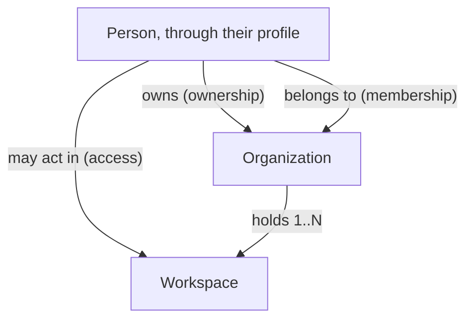

# Access domain

The people, companies and workspaces of the product, and the three relations that tie them:
ownership, membership and access. Every business process that creates, reads or changes one of
these concepts references the invariants below by their identifier; it never restates them.

This file holds what several processes share. A rule that only one process uses stays in that
process's `process.md`.

Bounded context: Access owns every concept below except the person, whom the identity provider
establishes (ADR-ARCH-031). The workspace is the tenant: other modules isolate their data by
workspace. Roles and permissions are not modelled
here: no process produces them yet.

## Concepts

| Concept | Meaning |
|---|---|
| Person | Someone who has authenticated with the platform. |
| Profile | How the product knows a person: the anchor every ownership, membership and access refers to. It records no business fact of its own. |
| Organization | A client company, as declared by the person who founded it. Its status is Declared or Verified. |
| Workspace | An autonomous operational space of an organization: an agency, a region, an activity. Its team does not necessarily see the data of the organization's other workspaces. |
| Ownership | The relation saying to whom an organization belongs. It is not an authorization. |
| Organization membership | The relation saying who belongs to the organization's people. It is not an authorization. |
| Workspace access | The relation saying who may act in a workspace. It is the only authorization relation of this domain so far; no relation authorizes a person at the scope of a whole organization. |

A relation is **current** from its creation until it is ended. Ending a relation keeps the record
that it existed.

## Invariants

- **INV-ACCESS-01** — A person has at most one profile. A person has one as soon as they take part
  in any ownership, membership or access, and every such relation refers to the person through it.
- **INV-ACCESS-02** — From its founding on, an organization has exactly one current owner, at all
  times.
- **INV-ACCESS-03** — From its founding on, an organization holds at least one workspace. No process
  ends a workspace yet.
- **INV-ACCESS-04** — A workspace belongs to exactly one organization, for its whole life. Its name
  is unique among the workspaces of that organization; two organizations may use the same name.
- **INV-ACCESS-05** — Ownership, membership and access are three distinct relations. None is
  derived from another: owning an organization or belonging to it never, by itself, lets a person
  act in a workspace. A member with no current access can act in no workspace, and that is a
  coherent state, not a defect.
- **INV-ACCESS-06** — A person holds at most one current membership per organization.
- **INV-ACCESS-07** — A person holds at most one current access per workspace. Every access can be
  ended.
- **INV-ACCESS-08** — An organization is created Declared. It becomes Verified only through
  verification (BP-009). Nobody's claim to represent a company is checked at founding
  (ADR-PROD-002).
- **INV-ACCESS-09** — A person learns that an organization, one of its workspaces or one of its
  relations exists only through a current relation of their own (ownership or membership for the
  organization, access for a workspace), or through an invitation addressed to them (BP-003). To
  everyone else, an organization is invisible, its existence included. The one thing a creation
  may reveal is that a reference it carries is already in use, never what uses it.

## Who produces what

| Concept or relation | Created by | Changed or ended by |
|---|---|---|
| Profile | The first process in which the person takes part in a relation (BP-001, BP-004) | — |
| Organization | BP-001 | BP-009 (status) |
| Workspace | BP-001 (the first), BP-007 (others) | — |
| Ownership | BP-001 | BP-008 |
| Organization membership | BP-001 (the founder), BP-004 (others) | BP-005 |
| Workspace access | BP-001 (the founder, first workspace), BP-004, BP-007 | BP-005 |
